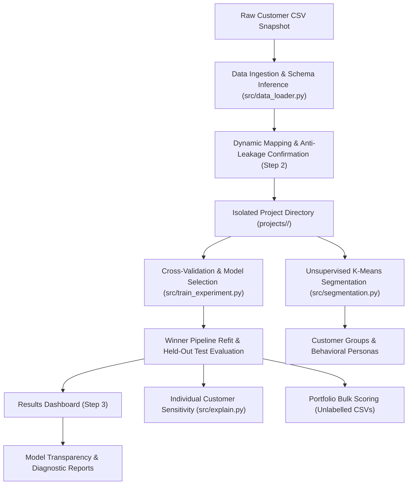

# AI Customer Analytics & Churn Prediction (ChurnGuide)
## Comprehensive B.Tech Major Project Technical Guide & Viva Reference Manual

---

### Table of Contents
1. [Executive Summary & Project Mandate](#1-executive-summary--project-mandate)
2. [System Architecture & Workflow](#2-system-architecture--workflow)
3. [The Tabular Snapshot Contract & Scope Boundaries](#3-the-tabular-snapshot-contract--scope-boundaries)
4. [Data Leakage Prevention & Scientific Protocol](#4-data-leakage-prevention--scientific-protocol)
5. [Mathematical Formulations of Machine Learning Algorithms](#5-mathematical-formulations-of-machine-learning-algorithms)
   - [5.1 Logistic Regression](#51-logistic-regression)
   - [5.2 Random Forest Classifier](#52-random-forest-classifier)
   - [5.3 Gradient Boosting Classifier](#53-gradient-boosting-classifier)
   - [5.4 Unsupervised K-Means Customer Segmentation](#54-unsupervised-k-means-customer-segmentation)
   - [5.5 One-at-a-Time Marginal Perturbation Sensitivity](#55-one-at-a-time-marginal-perturbation-sensitivity)
6. [Dynamic Multi-Project Architecture & Persistence](#6-dynamic-multi-project-architecture--persistence)
7. [Empirical Experimental Results & Benchmark Evaluation](#7-empirical-experimental-results--benchmark-evaluation)
8. [Dataset Provenance, Licensing & Ethical Considerations](#8-dataset-provenance-licensing--ethical-considerations)
9. [Viva Voce Examination Questions & Model Answers](#9-viva-voce-examination-questions--model-answers)

---

### 1. Executive Summary & Project Mandate

Customer attrition ("churn") represents the proportion of contractual or transactional subscribers who terminate their service relationship over a specified temporal window. Retaining an existing customer costs between five to seven times less than acquiring a new customer across telecommunications, cloud software (SaaS), banking, and digital media industries. 

**ChurnGuide** is an open-architecture, light-themed, enterprise-grade customer analytics and machine learning platform built as a final-year B.Tech Major Capstone Project. Unlike monolithic applications with hardcoded assumptions, ChurnGuide dynamically supports arbitrary tabular business snapshots, enforces strict mathematical boundaries against data leakage, conducts automated cross-validation model selection across three foundational algorithm families, generates unsupervised behavioral cohorts via K-Means clustering, and derives row-level sensitivity attributions without making false causal claims.

---

### 2. System Architecture & Workflow

The platform follows a modular, decoupled architecture organized into distinct functional layers:



#### Core Components Directory Map
- `app.py`: Flask application server coordinating routing, session state, flash alerts, and template rendering.
- `src/data_loader.py`: CSV ingestion, schema inference, missingness profiling, whitespace handling, and strict schema validation.
- `src/train_experiment.py`: Scikit-learn `Pipeline` and `ColumnTransformer` builder, Stratified 5-Fold CV hyperparameter tuning, model winner selection, held-out test evaluation, and diagnostic plotting.
- `src/segmentation.py`: Unsupervised K-Means clustering ($k=4$), feature standardization, median persona profiling, and honest fallback when numeric features are insufficient.
- `src/explain.py`: One-at-a-Time Marginal Perturbation Sensitivity testing and rule-based review heuristics.
- `src/project_manager.py`: Project lifecycle management, isolated directory generation, dataset immutability, and active project state persistence via `active_project.json`.

---

### 3. The Tabular Snapshot Contract & Scope Boundaries

#### 3.1 Supported Input Contract
To guarantee mathematical validity, ChurnGuide enforces the **Tabular Snapshot Input Contract**:
1. **One Row Per Customer:** Each record represents an individual customer snapshot observed at a unified historical time boundary $T_0$.
2. **Pre-Outcome Observation Window:** All feature columns (e.g. usage, tenure, payment method, support tickets) must reflect customer attributes strictly **prior** to $T_0$.
3. **Confirmed Binary Outcome:** Exactly one binary target column representing customer status over an observation window $[T_0, T_1]$ (e.g. 30 days post-observation). The target does not need to be named "Churn" or encoded "Yes/No", but must contain strictly two distinct classes with at least 10 observations per class.

#### 3.2 Explicitly Out-of-Scope Formats
- **Raw Transaction / Clickstream Event Logs:** Unaggregated time-series event streams (e.g. Apache Kafka logs, server access logs) require temporal aggregation and windowing prior to ingestion.
- **Automatic Future Label Generation:** The platform does not synthesize hypothetical future outcomes; supervised training requires ground-truth historical outcomes.
- **Arbitrary Unstructured Documents:** Plain text files, audio recordings, or non-tabular files are rejected.

---

### 4. Data Leakage Prevention & Scientific Protocol

Data leakage occurs when information from outside the training partition influences feature transformation, imputation, scaling, or model parameter selection, resulting in overly optimistic performance metrics that fail in production.

#### 4.1 Strict Leakage Prevention Architecture
1. **Stratified 80/20 Partitioning:** The dataset is partitioned into an 80% training set ($D_{train}$) and a 20% test set ($D_{test}$) using stratified sampling (`random_state=42`) to preserve the exact class ratio.
2. **Frozen Held-Out Test Set:** $D_{test}$ is completely sealed off. No preprocessing statistics (e.g. mean, median, category levels) are derived from $D_{test}$.
3. **Encapsulated Pipelines:** Preprocessing is encapsulated inside a scikit-learn `Pipeline`:
   - Numeric features: `SimpleImputer(strategy='median')` followed by `StandardScaler()`.
   - Categorical features: `SimpleImputer(strategy='most_frequent')` followed by `OneHotEncoder(drop='first', handle_unknown='ignore')`.
   Transformers are fitted **strictly on training folds** during cross-validation, and never on validation folds or test rows.
4. **Single Final Evaluation:** Hyperparameters and algorithms are selected exclusively via 5-Fold Cross-Validation on $D_{train}$. The selected pipeline is refitted on all of $D_{train}$ and evaluated **exactly once** on $D_{test}$.

#### 4.2 Longitudinal Operational Disclaimer
> [!IMPORTANT]
> Cross-sectional snapshot evaluation measures historical statistical association within a fixed observational slice. True operational forecasting in production environments requires **longitudinal temporal forward testing** (training on data prior to time $T_A$ and evaluating on data strictly after $T_B$) to guard against concept drift and macroeconomic shifts.

---

### 5. Mathematical Formulations of Machine Learning Algorithms

#### 5.1 Logistic Regression
Logistic Regression models the posterior probability of the positive churn class ($Y=1$) using a linear combination of input features mapped through the logistic sigmoid function:

$$z = \beta_0 + \sum_{j=1}^p \beta_j x_j$$

$$P(Y=1|X) = \sigma(z) = \frac{1}{1 + e^{-z}} = \frac{1}{1 + \exp\left(-\left(\beta_0 + \sum_{j=1}^p \beta_j x_j\right)\right)}$$

The model parameters $\beta$ are estimated by minimizing the $L_2$-regularized Binary Cross-Entropy (Log-Loss) objective function:

$$J(\beta) = -\frac{1}{N} \sum_{i=1}^N \left[ y_i \ln(p_i) + (1 - y_i) \ln(1 - p_i) \right] + \frac{1}{2C} \sum_{j=1}^p \beta_j^2$$

where $C > 0$ represents the inverse regularization strength. Smaller values of $C$ enforce stronger regularization, shrinking coefficients toward zero to mitigate overfitting.

#### 5.2 Random Forest Classifier
Random Forest is an ensemble learning method that constructs $B$ decorrelated decision trees using **Bootstrap Aggregation (Bagging)** and **Random Subspace Feature Selection**:
1. For each tree $b \in \{1, \dots, B\}$, sample $N$ instances with replacement from $D_{train}$ (bootstrap sample).
2. At each node split, randomly select a subset of $m = \lfloor\sqrt{p}\rfloor$ candidate features out of all $p$ features.
3. Choose the optimal feature and split threshold that maximizes Gini Impurity reduction:

$$I_G(t) = 1 - \sum_{k=0}^1 p_k^2(t)$$

$$\Delta I_G(s, t) = I_G(t) - \frac{N_L}{N_t} I_G(t_L) - \frac{N_R}{N_t} I_G(t_R)$$

4. The ensemble predicted probability is the unweighted average across all $B$ independent trees:

$$P(Y=1|X) = \frac{1}{B} \sum_{b=1}^B P_b(Y=1|X)$$

#### 5.3 Gradient Boosting Classifier
Gradient Boosting constructs an additive sequence of $M$ shallow regression trees (typically depth 3–4), where each subsequent tree fits the negative gradient of the loss function (pseudo-residuals) with respect to the current ensemble prediction:

Let the loss function be the binary deviance:
$$L(y, F(x)) = \ln(1 + \exp(-2 \tilde{y} F(x))), \quad \tilde{y} \in \{-1, +1\}$$

1. **Initialization:** Initialize ensemble with optimal constant log-odds:
   $$F_0(x) = \frac{1}{2} \ln\left(\frac{P(Y=1)}{1 - P(Y=1)}\right)$$
2. **Iterative Boosting Step ($m = 1 \dots M$):**
   - Compute pseudo-residuals for each sample $i$:
     $$r_{im} = -\left[\frac{\partial L(y_i, F(x_i))}{\partial F(x_i)}\right]_{F(x) = F_{m-1}(x)} = y_i - \sigma(2 F_{m-1}(x_i))$$
   - Fit a regression tree $h_m(x)$ to the pseudo-residuals $\{ (x_i, r_{im}) \}_{i=1}^N$.
   - Compute terminal leaf values $\gamma_{j m}$ via one-step Newton-Raphson approximation.
   - Update ensemble using shrinkage rate $\eta \in (0, 1]$:
     $$F_m(x) = F_{m-1}(x) + \eta \sum_{j} \gamma_{j m} \cdot \mathbb{I}(x \in R_{j m})$$
3. **Probability Conversion:**
   $$P(Y=1|X) = \frac{1}{1 + \exp(-2 F_M(x))}$$

#### 5.4 Unsupervised K-Means Customer Segmentation
To discover behavioral cohorts without relying on target labels (preventing target contamination), K-Means clustering partitions the standardized numerical feature space into $K$ disjoint clusters $S = \{S_1, S_2, \dots, S_K\}$:

1. **Standardization:** All continuous numeric features are normalized to zero mean and unit variance ($z$-score scaling):
   $$z = \frac{x - \mu}{\sigma}$$
2. **Objective Minimization:** Minimize within-cluster sum of squares (inertia):
   $$\arg\min_S \sum_{k=1}^K \sum_{x \in S_k} ||x - \mu_k||_2^2$$
3. **Lloyd's Algorithm:**
   - **Assignment Step:** Assign each customer $x_i$ to the nearest centroid $\mu_k$:
     $$S_k^{(t)} = \left\{ x_i : ||x_i - \mu_k^{(t)}||^2 \le ||x_i - \mu_j^{(t)}||^2, \, \forall j \right\}$$
   - **Update Step:** Recompute centroid as the arithmetic mean of assigned points:
     $$\mu_k^{(t+1)} = \frac{1}{|S_k^{(t)}|} \sum_{x_i \in S_k^{(t)}} x_i$$
4. **Cohort Profiling:** For each cluster, empirical median statistics, percentage of customer base, and retrospective historical churn rates are tabulated.

#### 5.5 One-at-a-Time Marginal Perturbation Sensitivity
Rather than fabricating opaque attribution values, ChurnGuide implements genuine **One-at-a-Time Marginal Perturbation Sensitivity** relative to training-fold typical baseline values ($X_{base}$, medians for numerics, modes for categoricals):

$$\Delta P(f) = P(Y=1 | X_{cust}) - P(Y=1 | X_{perturbed}^{(f)})$$

where $X_{perturbed}^{(f)}$ is the customer's vector with feature $f$ replaced by its cohort baseline value $X_{base}^{(f)}$. 

- If $\Delta P(f) > 0$: The customer's current value of feature $f$ **increases** estimated churn risk relative to the typical subscriber.
- If $\Delta P(f) < 0$: The customer's current value acts as a **protective factor** decreasing churn risk.
- **Scientific Caveat:** Perturbation sensitivities represent *empirical model associations*, not proven causal interventions.

---

### 6. Dynamic Multi-Project Architecture & Persistence

To support diverse business domains without cross-contamination, projects are isolated on the filesystem:

```
projects/
├── active_project.json           # Tracks globally active project ID
├── telecom_public_demo/          # Pre-trained IBM Telco project
│   ├── config.json               # Schema mapping, target, positive label
│   ├── dataset.csv               # Immutable snapshot copy
│   ├── pipeline.joblib           # Trained winning scikit-learn Pipeline
│   ├── metadata.json             # CV results, test metrics, baseline medians
│   ├── segmentation.json         # K-Means clusters and persona descriptions
│   └── plots/                    # Confusion matrix, ROC curve, importances
└── saas_b2b_demo/                # Pre-trained B2B SaaS synthetic fixture
    ├── config.json
    ├── dataset.csv
    ├── pipeline.joblib
    ├── metadata.json
    ├── segmentation.json
    └── plots/
```

#### Safe Project Switching & Atomic Training
1. **Isolated Storage:** Each project owns its own `config.json`, dataset copy, pipeline, and plots.
2. **State Persistence:** `projects/active_project.json` stores the current active project ID, persisting across browser reloads without depending on fragile environment variables.
3. **Atomic Training Isolation:** When training a new project, files are staged in a separate temporary directory. If validation or training fails, the temporary directory is deleted immediately, leaving the active model completely uncorrupted.

---

### 7. Empirical Experimental Results & Benchmark Evaluation

All metrics reported below were generated directly from actual training runs (`random_state=42`) and can be reproduced on demand:

#### 7.1 Cross-Validation Benchmark Comparison (80% Training Set)
| Dataset / Domain | Model Candidate | Tested Hyperparameters | Optimal Hyperparameters | Mean CV ROC-AUC | Std Dev | Winner Status |
| :--- | :--- | :--- | :--- | :---: | :---: | :---: |
| **Telecom (Public)** | Logistic Regression | $C \in [0.01, 0.1, 1.0, 10.0]$ | $C = 10.0$ | 0.8463 | $\pm 0.0128$ | Candidate |
| **Telecom (Public)** | Random Forest | $n\_est \in [50, 100], depth \in [5, 10]$ | $n\_est = 50, depth = 5$ | 0.8446 | $\pm 0.0115$ | Candidate |
| **Telecom (Public)** | **Gradient Boosting** | $lr \in [0.05, 0.1], depth \in [3, 4], n\_est \in [50, 100]$ | **$lr = 0.05, depth = 3, n\_est = 100$** | **0.8493** | $\pm 0.0129$ | **WINNER** |
| **B2B SaaS (Synthetic)** | **Logistic Regression** | $C \in [0.01, 0.1, 1.0, 10.0]$ | **$C = 1.0$** | **0.7084** | $\pm 0.0241$ | **WINNER** |
| **B2B SaaS (Synthetic)** | Random Forest | $n\_est \in [50, 100], depth \in [5, 10]$ | $n\_est = 100, depth = 5$ | 0.6972 | $\pm 0.0278$ | Candidate |
| **B2B SaaS (Synthetic)** | Gradient Boosting | $lr \in [0.05, 0.1], depth \in [3, 4], n\_est \in [50, 100]$ | $lr = 0.05, depth = 3, n\_est = 50$ | 0.6985 | $\pm 0.0264$ | Candidate |

#### 7.2 Single Held-Out Test Set Evaluation (20% Partition)
| Metric | Telecom Public Demo (GBM) | B2B SaaS Subscription Demo (LogReg) |
| :--- | :---: | :---: |
| **Test Set Size** | 1,409 customers | 240 enterprise accounts |
| **Test Accuracy** | **79.84%** | **66.25%** |
| **Test ROC-AUC** | **0.8465** | **0.7246** |
| **Test Precision** | **65.85%** | **45.00%** |
| **Test Recall** | **50.00%** | **35.29%** |
| **Test F1-Score** | **0.5684** | **0.3956** |

#### 7.3 Discussion of Class Imbalance & Recall Behavior
In customer churn datasets, the positive churn class typically represents 20%–30% of accounts. Consequently, classifiers optimized for unweighted cross-entropy loss prioritize overall accuracy and precision, leading to lower recall on churners (50.0% in Telecom, 35.3% in SaaS). In operational deployment where false negatives (missing a customer who churns) carry higher costs than false positives (sending a retention coupon to a retained customer), the decision threshold can be lowered from 0.50 to 0.35 during bulk scoring.

---

### 8. Dataset Provenance, Licensing & Ethical Considerations

1. **Telecom Customer Churn Sample:**
   - **Source:** IBM Telco Customer Churn provisional dataset repository: `https://raw.githubusercontent.com/IBM/telco-customer-churn-on-icp4d/master/data/Telco-Customer-Churn.csv`
   - **License:** The host repository includes an Apache-2.0 license file. The CSV is utilized as a public academic sample for B.Tech project benchmarking. It is never misrepresented as client data.
   - **Attributes:** 7,043 rows, 21 columns, 11 whitespace blanks in `TotalCharges` imputed via training median.
2. **B2B SaaS Subscription Benchmark Fixture:**
   - **File:** `data/saas_customer_churn.csv`
   - **Provenance:** Explicitly generated as a **SYNTHETIC benchmark fixture** to verify multi-domain software plumbing, custom column mapping, and non-telecom workflows.
   - **Attributes:** 1,200 accounts, 13 features (`Weekly_Active_Users`, `Support_Tickets_90d`, `Feature_Adoption_Score`, etc.), target `Status` ("Churned" vs "Active").
3. **Data Privacy & Governance:**
   - The platform operates 100% locally and offline without external API telemetry or third-party cloud data transmission.
   - Customer IDs are strictly excluded from feature sets to prevent identification bias.

---

### 9. Viva Voce Examination Questions & Model Answers

#### Q1: What is data leakage, and how does ChurnGuide mathematically prevent it?
**Answer:** Data leakage occurs when test or future information contaminates the model training process. In ChurnGuide, leakage is prevented on three architectural levels:
1. An 80/20 train/test stratified split is applied first; the 20% test partition is frozen immediately.
2. All preprocessing (median imputation for numeric blanks, standard scaling, and one-hot encoding) is encapsulated inside a scikit-learn `Pipeline` and fitted *only on training folds* during cross-validation.
3. Test rows are evaluated exactly once on the frozen pipeline after all hyperparameter tuning is complete.

#### Q2: Why did Gradient Boosting outperform Logistic Regression on Telecom, while Logistic Regression won on B2B SaaS?
**Answer:** 
- The Telecom dataset contains strong non-linear interactions (e.g. high monthly spend coupled with month-to-month contracts and fiber-optic internet), which gradient boosted decision trees capture naturally through hierarchical axis-aligned feature splits.
- The synthetic B2B SaaS dataset exhibits smoother, monotonic relationships with moderate noise across continuous metrics (`Feature_Adoption_Score`, `Contract_Age_Months`), allowing regularized Logistic Regression ($L_2$ penalty) to generalize better without overfitting to small subgroup anomalies.

#### Q3: Why is ROC-AUC preferred over Accuracy as the selection metric?
**Answer:** Churn datasets are class-imbalanced (e.g., 26.5% churn prevalence). A trivial dummy classifier predicting "No Churn" for every customer would achieve 73.5% accuracy while possessing zero practical utility. ROC-AUC (Area Under the Receiver Operating Characteristic Curve) evaluates the classifier's ability to rank a randomly chosen churner higher than a randomly chosen non-churner across all possible decision thresholds, making it threshold-independent and invariant to class balance shifts.

#### Q4: How is row-level explainability implemented without deep learning SHAP overhead?
**Answer:** ChurnGuide implements **One-at-a-Time Marginal Perturbation Sensitivity**:
$$\Delta P(f) = P(Churn | X) - P(Churn | X_{perturbed}^{(f)})$$
where $X_{perturbed}^{(f)}$ replaces feature $f$ with its training-fold baseline (median for numeric, mode for categorical). This calculates the exact empirical probability shift attributed to that feature's deviation from cohort norms. It is computationally lightweight, offline, and truthfully disclaimed as model sensitivity rather than causal attribution.

#### Q5: Why is K-Means clustering run on numeric features instead of all one-hot encoded categoricals?
**Answer:** In high-dimensional spaces with sparse one-hot encoded binary features, Euclidean distance degenerates due to the curse of dimensionality (distances between all pairs of points become equidistant). Furthermore, computing geometric centroids on one-hot features creates fractional pseudo-categories (e.g. centroid = 0.35 Contract). Running K-Means on standardized continuous metrics ($z$-scores) ensures meaningful geometric distance metrics while preserving clear cluster centroids.

#### Q6: What is the limitation of a cross-sectional snapshot model for operational churn forecasting?
**Answer:** A cross-sectional snapshot assumes the customer attribute distribution at observation time $T_0$ remains stationary. In operational production forecasting, macro-market dynamics, competitor pricing changes, and seasonal shifts cause concept drift. Operational deployment requires **temporal forward testing** (evaluating models trained on quarter $Q_1$ against outcomes in quarter $Q_2$) to verify temporal stability.

#### Q7: How is zero-configuration cross-platform deployment achieved for both Windows and macOS?
**Answer:** The platform features platform-native one-click launchers:
1. **Windows (`START_HERE.bat`):** Detects existing Python or silently installs official Python 3.12 via Windows Package Manager (`winget`) or PowerShell web bootstrapping. Features a fast-path cache that launches the local server in under 2 seconds on subsequent runs.
2. **macOS (`START_HERE.command` / `START_HERE.sh`):** Double-clickable native shell script for macOS Finder that auto-detects Apple Silicon (`/opt/homebrew`) and Intel paths, provisions Python 3.10+, configures a clean virtual environment, and automatically opens the dashboard in Safari/Chrome.
3. **Completely Local & Offline:** Operates entirely within standard workstation memory without cloud APIs, subscription keys, or external network data transmission.

